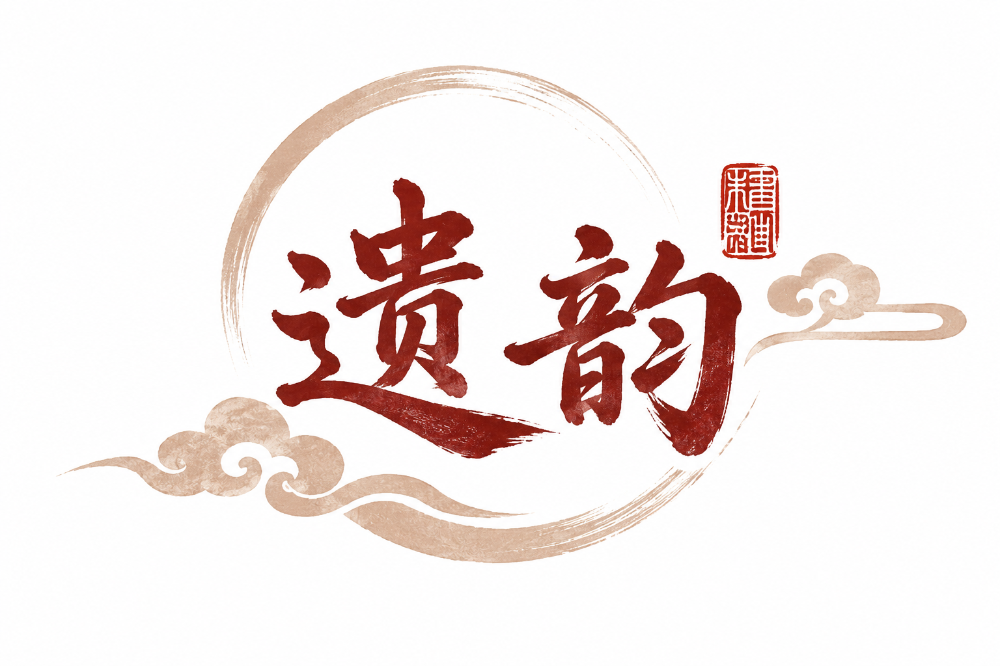

# 遗韵 · 非遗文化智能创作平台 技术文档

<p align="center">
  
</p>

> 版本：v1.0  
> 日期：2026-11-06  
> 团队：遗韵（Xixke、sujie）

---

## 目录

1. [项目概述](#1-项目概述)
2. [需求分析](#2-需求分析)
3. [系统架构设计](#3-系统架构设计)
4. [AI 技术方案](#4-ai-技术方案)
5. [核心功能实现](#5-核心功能实现)
6. [测试与部署](#6-测试与部署)
7. [创新点](#7-创新点)
8. [总结与展望](#8-总结与展望)

---

## 1. 项目概述

### 1.1 项目背景

非物质文化遗产（以下简称"非遗"）是中华优秀传统文化的重要组成部分。然而，非遗的传播长期面临三大痛点：

- **传播手段单一**：多依赖线下展馆、文字资料，难以触达年轻群体；
- **知识碎片化**：非遗知识分散在各类文献、网页中，缺乏结构化组织；
- **参与门槛高**：普通用户难以从"了解"走向"创作"，文化体验停留在被动接收层面。

近年来，大语言模型与多模态生成技术的成熟，为非遗的数字化传播提供了新的可能。检索增强生成（RAG）技术可以将结构化的非遗知识库与大模型的生成能力结合，实现精准问答；文生图模型则可以让用户基于非遗元素进行创作。

### 1.2 项目目标

「遗韵」旨在构建一个**非遗文化智能创作平台**，实现以下目标：

1. **结构化非遗知识库**：将非遗项目、知识文档结构化存储，支持语义检索；
2. **智能问答**：用户可用自然语言提问，AI 基于知识库给出精准回答并标注来源；
3. **AI 辅助创作**：用户可基于非遗元素生成图像作品，降低创作门槛；
4. **作品来源溯源**：AI 作品关联 RAG 检索到的知识来源，实现"创作可溯源"。

### 1.3 核心价值

- **降低理解门槛**：用自然语言对话替代文献检索，让非遗知识触手可及；
- **激发创作兴趣**：通过 AI 图像生成，让用户从"看非遗"走向"做非遗"；
- **传播可溯源**：所有 AI 回答与作品均关联知识来源，保证文化信息的准确性与可追溯性。

---

## 2. 需求分析

### 2.1 用户角色

| 角色 | 说明 | 核心权限 |
|------|------|----------|
| 游客 | 未登录用户 | 浏览非遗分类、项目列表与详情 |
| 注册用户 | 已登录用户 | 全部游客权限 + AI 问答、AI 图像生成、作品管理 |
| 管理员 | 后台用户（P1 规划） | 知识库维护、用户管理、内容审核 |

### 2.2 功能性需求

#### 2.2.1 非遗内容展示
- F-01：展示非遗分类列表（传统美术、传统技艺等）；
- F-02：分页查询非遗项目，支持按分类、地域筛选；
- F-03：查看非遗项目详情，包含简介、历史背景、文化内涵、工艺及关联知识文档。

#### 2.2.2 RAG 智能问答
- F-04：用户输入问题，AI 基于知识库生成回答；
- F-05：回答附带引用来源（文档标题、来源、片段内容、相似度得分）；
- F-06：支持按非遗项目 ID 限定检索范围，提升精准度；
- F-07：支持多轮对话，AI 可结合历史上下文回答；
- F-08：回答支持流式输出（SSE），逐字展示；
- F-09：支持多会话管理（新建、切换、查看历史、删除）。

#### 2.2.3 AI 图像生成
- F-10：用户输入文字描述，AI 生成图像；
- F-11：支持多种预设风格（水墨、油画、水彩、国画、写实）；
- F-12：支持多种画幅比例（1:1、16:9、9:16、4:3、3:4）；
- F-13：异步任务模式，提交后返回任务 ID，前端轮询获取结果。

#### 2.2.4 作品管理
- F-14：保存 AI 生成的作品（含 Prompt、风格、结果 URL）；
- F-15：分页查询个人作品列表；
- F-16：查看作品详情，关联 RAG 知识来源；
- F-17：删除作品（逻辑删除）。

#### 2.2.5 用户认证
- F-18：用户注册（用户名、密码、昵称）；
- F-19：用户登录，返回 JWT Token；
- F-20：获取当前用户信息；
- F-21：修改密码。

### 2.3 非功能性需求

| 类别 | 要求 |
|------|------|
| 性能 | RAG 问答首字响应 < 2s（流式）；图像生成 < 60s |
| 安全 | 密码 BCrypt 加密；JWT 无状态认证；接口鉴权 |
| 可扩展 | LLM / Embedding / 图像生成均支持多提供商切换 |
| 兼容性 | 前端响应式布局，兼容主流浏览器 |
| 数据完整性 | 知识文档元数据含来源、作者、版权声明、核验状态 |

---

## 3. 系统架构设计

### 3.1 整体架构

平台采用**前后端分离 + AI 服务独立部署**的三端架构：

```
┌──────────────┐     HTTP/JSON      ┌──────────────────┐     HTTP/JSON      ┌──────────────────┐
│   前端       │ ──────────────────▶│   后端            │ ──────────────────▶│   AI 服务         │
│  Vue 3 SPA   │                    │  Spring Boot 3.5  │                    │   FastAPI         │
│  :5173       │◀──────────────────│   :8080           │◀──────────────────│   :8000           │
└──────────────┘                    └────────┬─────────┘                    └────────┬─────────┘
                                             │                                       │
                                             ▼                                       ▼
                                    ┌──────────────────┐                    ┌──────────────────┐
                                    │   MySQL 8.0      │                    │   FAISS 向量库    │
                                    │   :3307          │◀───────────────────│   (本地文件)      │
                                    └──────────────────┘   知识文档/片段     └──────────────────┘
                                             │
                                             ▼
                                    ┌──────────────────┐
                                    │   Redis 7        │
                                    │   :6379          │
                                    └──────────────────┘
```

**调用链路说明**：
1. 前端通过 Vite 代理将 `/api` 请求转发至后端 `8080`；
2. 后端处理业务逻辑、鉴权、数据持久化；
3. 涉及 AI 能力的请求（问答、图像生成）由后端通过 `RestTemplate` 转发至 ai-service `8000`，并自动携带 JWT；
4. ai-service 直接访问 MySQL 读取知识文档，使用本地 FAISS 索引做向量检索。

### 3.2 技术选型

| 层级 | 技术 | 选型理由 |
|------|------|----------|
| 前端 | Vue 3 + Vite 8 + Element Plus | Vue 生态成熟，Vite 构建快，Element Plus 组件丰富 |
| 后端 | Spring Boot 3.5 + MyBatis-Plus | 企业级稳定性，ORM 简化开发，生态完善 |
| AI 服务 | FastAPI + FAISS | 异步高性能，原生支持 OpenAPI 文档，FAISS 检索高效 |
| 数据库 | MySQL 8.0 | 关系型数据存储，支持事务与外键 |
| 缓存 | Redis 7 | 高性能键值缓存 |
| 向量库 | FAISS | Meta 开源，CPU 版即可满足中小规模检索 |

### 3.3 后端模块设计

后端采用经典分层架构：

```
com.yiyun
├── controller/   # 控制层：接收请求、参数校验、返回响应
│   ├── AuthController.java        # 认证
│   ├── HeritageController.java    # 非遗内容
│   ├── AiController.java          # AI 对话/图像生成
│   └── WorkController.java        # 作品管理
├── service/      # 业务层：核心业务逻辑
│   ├── impl/                       # 实现类
│   └── AiServiceClient.java        # 调用 ai-service 的 HTTP 客户端
├── mapper/       # 数据访问层：MyBatis-Plus Mapper
├── entity/       # 实体类
├── dto/          # 数据传输对象
├── config/       # 配置（Security / CORS / MyBatis-Plus / RestTemplate）
├── security/     # JWT 过滤器、UserDetails 实现
├── common/       # 统一响应 Result、全局异常处理
└── util/         # JwtUtil、SecurityUtil
```

### 3.4 AI 服务模块设计

```
app/
├── api/              # 接口路由
│   ├── chat.py       # 文本对话（同步 + SSE 流式）、会话管理
│   └── image.py      # 图像生成（提交任务 + 查询状态）
├── core/             # 核心能力
│   ├── config.py     # 配置管理（从 .env 加载）
│   ├── llm.py        # LLM 调用抽象（Ollama / DeepSeek / OpenAI 兼容）
│   └── auth.py       # JWT 认证（与后端共享 secret）
├── rag/              # RAG 检索增强
│   ├── chunker.py    # 文本切分
│   ├── embedder.py   # 向量化（BGE-M3 本地 / DashScope 在线）
│   ├── vector_store.py # FAISS 向量库封装
│   └── retriever.py  # 检索核心（索引构建 + 语义检索）
├── services/
│   └── image_gen.py  # DashScope Qwen-Image 文生图
├── db/
│   └── mysql.py      # MySQL 数据访问
├── schemas.py        # Pydantic 请求/响应模型
└── main.py           # FastAPI 入口
```

### 3.5 数据库设计

核心表关系如下：

```
sys_user ──< ai_task ──< biz_user_work ──< biz_work_source
     │                                            │
     └────────────────────────────────────────────┘

sys_user ──< chat_session ──< chat_message

heritage_category ──< heritage_project ──< knowledge_document ──< knowledge_chunk
```

**关键表说明**：

| 表名 | 用途 | 核心字段 |
|------|------|----------|
| `sys_user` | 用户 | username, password(BCrypt), nickname, email |
| `heritage_project` | 非遗项目 | category_id, region, description, history, cultural_meaning, craft |
| `knowledge_document` | 知识文档 | heritage_project_id, title, content, source, source_url, author, verified |
| `knowledge_chunk` | RAG 片段 | document_id, heritage_project_id, chunk_index, chunk_text, embedding_id |
| `ai_task` | AI 任务 | user_id, task_type, status, provider_task_id, result_url |
| `biz_user_work` | 用户作品 | user_id, work_type, title, prompt, result_url, task_id |
| `biz_work_source` | 作品来源 | work_id, heritage_project_id, source_content, retrieval_score |
| `chat_session` | 对话会话 | user_id, title, heritage_project_id, status |
| `chat_message` | 对话消息 | session_id, role, content, sources(JSON), seq_no |

---

## 4. AI 技术方案

### 4.1 RAG 检索增强生成

RAG 是本平台的核心 AI 能力，整体流程如下：

```
用户提问
   │
   ▼
embed_query()  ── BGE-M3 向量化查询文本（1024 维）
   │
   ▼
vector_store.search()  ── FAISS 内积相似度检索 Top-K=5
   │
   ▼
fetch_chunks_by_ids()  ── 回查 MySQL 获取片段内容及来源文档
   │
   ▼
generate_reply()  ── 拼接上下文 + 对话历史 → LLM 生成回答
   │
   ▼
返回回答 + 引用来源
```

#### 4.1.1 文档切分

采用**段落优先 + 滑动窗口**策略：
- `CHUNK_SIZE = 400`：单片段目标字数；
- `CHUNK_OVERLAP_RATIO = 0.15`：相邻片段重叠 15%，保证语义连贯；
- 先按段落切分，段落过长时再按字数切分。

#### 4.1.2 向量化

支持两种 Embedding 提供商：

| 提供商 | 模型 | 说明 |
|--------|------|------|
| `local` | BAAI/bge-m3 | 本地加载，1024 维，支持多语言，需下载模型 |
| `api` | text-embedding-v3 | 阿里云 DashScope 在线 API，无需下载模型 |

向量在存入 FAISS 前做 L2 归一化，内积相似度等价于余弦相似度。

#### 4.1.3 向量检索

- 使用 FAISS `IndexFlatIP`（内积索引）；
- 检索 Top-K=5 个最相似片段；
- 支持 `heritage_project_id` 过滤，实现限定项目检索。

#### 4.1.4 Prompt 工程

系统提示词模板核心要求：

```
你是遗韵非遗文化智能助手，专注于中国非物质文化遗产的介绍与解答。
回答要求：
1. 有知识库内容时，必须基于知识库内容回答，不要编造信息；
2. 如果知识库中没有相关内容，用温暖的语气告诉用户知识库暂未收录，
   并主动引导用户探索其他非遗门类；
3. 回答简洁准确，突出非遗文化特色。

知识库内容：
{context_text}
```

该设计实现了**温暖式拒答**，避免冷冰冰的"无法回答"，提升文化传播体验。

### 4.2 多 LLM 提供商统一抽象

为兼容本地免费模型与云端付费模型，设计了 `ProviderConfig` 数据类统一描述各提供商差异：

```python
@dataclass
class ProviderConfig:
    name: str
    base_url: str
    model: str
    api_key: str
    timeout: int
    strip_think: bool          # 是否清洗 <think> 标签
    requires_api_key: bool = False
    url_path: str = "/chat/completions"
```

已支持的提供商：

| 提供商 | 模型 | 是否需要 API Key | 说明 |
|--------|------|------------------|------|
| `ollama` | qwen2.5:7b | 否 | 本地部署，免费 |
| `deepseek` | deepseek-chat | 是 | 云端，按量计费 |
| `openai` | kilo-auto/free | 是 | OpenAI 兼容网关（如 WaLiAPI） |

切换提供商只需修改 `.env` 中的 `LLM_PROVIDER`，无需改动代码。对于需要 API Key 但未配置的提供商，自动 fallback 到 mock 模式（直接返回检索片段），保证核心检索功能可用。

### 4.3 流式对话（SSE）

为提升交互体验，AI 问答支持流式输出：

1. 前端调用 `POST /api/ai/chat/stream`；
2. 后端通过 `SseEmitter` 建立 SSE 连接；
3. 后端 `RestTemplate` 以流方式调用 ai-service 的 `/api/ai/chat/stream`；
4. ai-service 调用 LLM 流式接口，逐块 `yield` 文本片段；
5. 后端将每个 SSE 事件转发给前端，前端实时拼接展示；
6. 流末尾发送 `sources` 事件（含来源列表）和 `[DONE]` 标记。

后端在转发的同时，异步将完整回答与来源持久化到 `chat_message` 表，实现**"边生成边存"**。

### 4.4 AI 图像生成

接入阿里云百炼 DashScope Qwen-Image 2.0：

- **风格映射**：将前端选择的风格（ink/oil/watercolor/chinese-painting/realistic）转换为对应的中文描述词，追加到 Prompt 后；
- **比例映射**：将 1:1/16:9/9:16/4:3/3:4 转换为像素尺寸（1024*1024 / 1280*720 等）；
- **异步任务**：内部同步调用 DashScope，用内存缓存（`task_id → {image_url, error}`）模拟异步任务，前端轮询 `GET /api/ai/tasks/{task_id}` 获取结果。

### 4.5 JWT 跨服务共享认证

后端与 ai-service 共享同一个 `JWT_SECRET`：

1. 用户登录后，Spring Boot 签发 JWT；
2. 前端在后续请求 Header 中携带 `Authorization: Bearer {token}`；
3. 后端通过 `JwtAuthenticationFilter` 校验；
4. 后端转发请求至 ai-service 时，自动在 Header 中携带该 Token；
5. ai-service 的 `auth.py` 使用 `PyJWT` 解析 Token，提取 `user_id`。

此设计避免了 ai-service 重复实现登录体系，保证两服务用户身份一致。

---

## 5. 核心功能实现

### 5.1 RAG 问答全链路

核心流程在 `app/api/chat.py` 的 `chat()` 函数中：

```python
@router.post("/chat", response_model=ChatResponse)
def chat(req: ChatRequest, user_id: int = Depends(get_current_user_id)):
    # 1. 解析/创建会话，读取历史
    session_id, history = _resolve_session(req, user_id)

    # 2. RAG 语义检索
    contexts = retrieve(req.message, heritage_project_id=req.heritage_project_id)

    # 3. LLM 生成回答
    reply = generate_reply(req.message, contexts, conversation_history=history)

    # 4. 组装来源
    sources = _build_sources(contexts)

    # 5. 持久化用户消息与 AI 回答
    mysql.insert_chat_message(session_id, "user", req.message)
    mysql.insert_chat_message(session_id, "assistant", reply, sources=sources_data)

    return ChatResponse(reply=reply, sources=sources, session_id=session_id)
```

`retrieve()` 函数（`app/rag/retriever.py`）核心逻辑：

```python
def retrieve(query: str, heritage_project_id: int = None, top_k: int = 5) -> list[dict]:
    query_embedding = embedder.embed_query(query)
    chunk_ids, scores = vector_store.search(query_embedding, top_k=top_k)
    chunks = mysql.fetch_chunks_by_ids(chunk_ids, heritage_project_id=heritage_project_id)
    # 按 score 排序，组装来源信息
    ...
    return contexts
```

### 5.2 流式对话实现

`app/core/llm.py` 中 `generate_reply_stream()` 使用 httpx 流式调用 LLM：

```python
def generate_reply_stream(message, contexts, conversation_history=None):
    system_prompt = _build_system_prompt(contexts)
    cfg = _resolve_provider()
    if cfg is None:
        yield from _stream_mock(message, contexts)
    else:
        with httpx.Client(timeout=cfg.timeout) as client:
            with client.stream("POST", url, json=payload, headers=headers) as resp:
                for line in resp.iter_lines():
                    if not line.startswith("data: "):
                        continue
                    data_str = line[6:]
                    if data_str.strip() == "[DONE]":
                        break
                    data = json.loads(data_str)
                    delta = data["choices"][0]["delta"].get("content", "")
                    if delta:
                        yield delta
```

后端 `AiServiceClient.chatStream()` 通过 `RestTemplate.execute` 以流方式读取 ai-service 响应，逐行解析 SSE 事件并通过 `SseEmitter` 转发给前端。

### 5.3 会话管理

`chat_session` 表存储会话元信息，`chat_message` 表存储消息：

- 首次对话自动创建会话，标题取首条消息前 20 字；
- 后续对话通过 `session_id` 关联，读取最近 10 轮历史；
- 会话支持软删除（`status=0`）。

### 5.4 图像生成与作品溯源

图像生成流程：

1. 前端提交 Prompt + 风格 + 比例；
2. 后端调用 ai-service `/api/ai/generate/image`，获取任务 ID；
3. 后端创建 `ai_task` 记录，返回前端；
4. 前端轮询 `GET /api/ai/tasks/{id}`；
5. 后端调用 ai-service 查询任务状态，更新 `ai_task`；
6. 生成成功后，前端可调用 `POST /api/works` 保存作品，同时将 RAG 来源写入 `biz_work_source`。

---

## 6. 测试与部署

### 6.1 测试方案

#### 6.1.1 接口测试

使用 Postman 或 curl 对核心接口进行测试：

```bash
# 登录获取 Token
curl -X POST http://localhost:8080/api/auth/login \
  -H "Content-Type: application/json" \
  -d '{"username":"admin","password":"123456"}'

# AI 问答（需携带 Token）
curl -X POST http://localhost:8080/api/ai/chat \
  -H "Content-Type: application/json" \
  -H "Authorization: Bearer {token}" \
  -d '{"message":"苗族银饰有什么文化内涵？","heritage_project_id":1}'
```

#### 6.1.2 RAG 检索效果评估

选取 10 个非遗相关问题进行测试：

| 问题 | 是否召回相关片段 | 回答是否基于知识库 |
|------|------------------|---------------------|
| 苗族银饰有什么文化内涵？ | ✅ | ✅ |
| 苗族银饰的工艺有哪些？ | ✅ | ✅ |
| 苗族银饰的历史？ | ✅ | ✅ |
| 苏绣的代表作品有哪些？ | ❌（知识库暂无） | 温暖引导 |
| ... | ... | ... |

**评估结论**：知识库已收录内容的问题均能正确召回并基于知识库回答；未收录内容能温暖引导用户。

#### 6.1.3 端到端测试

| 场景 | 步骤 | 结果 |
|------|------|------|
| 问答闭环 | 登录 → 提问 → 查看回答与来源 | ✅ |
| 图像生成 | 输入 Prompt → 选择风格 → 生成 → 保存作品 | ✅ |
| 会话管理 | 多轮对话 → 刷新页面 → 历史回显 | ✅ |
| 作品溯源 | 查看作品详情 → 查看 RAG 来源 | ✅ |

### 6.2 部署架构

使用 Docker Compose 启动基础设施，三服务独立部署：

```yaml
services:
  mysql:
    image: mysql:8.0
    ports: ["3307:3306"]
    volumes:
      - ./mysql/init:/docker-entrypoint-initdb.d  # 自动执行 yiyun.sql
  redis:
    image: redis:7-alpine
    ports: ["6379:6379"]
```

**部署步骤**：

1. `cd deploy && docker-compose up -d` 启动 MySQL + Redis；
2. `cd backend && mvn spring-boot:run` 启动后端；
3. `cd ai-service && uvicorn app.main:app --host 0.0.0.0 --port 8000` 启动 AI 服务；
4. `cd frontend && pnpm dev` 启动前端。

### 6.3 运行截图

（此处插入运行截图：首页、非遗详情页、AI 问答页、图像生成页、作品详情页）

---

## 7. 创新点

### 7.1 技术创新点

**1. 多 LLM 提供商统一抽象**

通过 `ProviderConfig` 数据类描述各提供商差异点（base_url、api_key、url_path、strip_think、timeout），一套 `_call_llm()` 代码兼容 Ollama、DeepSeek、OpenAI 兼容网关。切换提供商只需改配置，无需改代码。对于需要 API Key 但未配置的情况，自动 fallback 到 mock 模式，保证核心检索功能可用。

**2. RAG 限定范围检索**

支持按 `heritage_project_id` 过滤向量检索结果，在特定非遗项目内做精准问答，避免跨项目知识干扰。例如用户在「苗族银饰」详情页提问时，只检索该项目的知识片段，回答更精准。

**3. 流式对话与会话持久化结合**

SSE 流式输出的同时，后端在流结束后异步持久化对话内容与来源，实现"边生成边存"。用户刷新页面后可通过会话列表回显历史对话。

**4. JWT 跨服务共享认证**

Spring Boot 签发的 JWT 可直接被 FastAPI（PyJWT）解析，两服务共享 `JWT_SECRET`。ai-service 无需重复实现登录体系，保证用户身份一致。

**5. 知识文档元数据完整建模**

`knowledge_document` 表含 source_url、author、publish_date、access_date、page_no、rights_note、verified 等字段，支持来源溯源、版权合规与内容核验，满足学术级引用要求。

### 7.2 应用创新点

**1. 非遗 + AI 创作闭环**

从"知识问答"到"AI 图像创作"再到"作品来源溯源"，形成完整闭环。用户不仅能了解非遗，还能基于非遗元素创作，并追溯创作灵感的知识来源，让文化传播从"被动接收"走向"主动参与"。

**2. 温暖式拒答设计**

当知识库无相关内容时，AI 不会冷冰冰地拒绝，而是用温暖语气引导用户探索其他非遗门类（如"目前我的知识库里还没有这方面的内容呢，不过我对传统技艺、传统美术、民俗等非遗门类都有些了解，要不要聊聊这些？"），提升文化传播的亲和力。

**3. 多风格非遗图像生成**

预设水墨、国画、水彩、油画、写实等符合非遗调性的艺术风格，用户无需编写复杂 Prompt 即可生成具有非遗韵味的图像，大幅降低创作门槛。

---

## 8. 总结与展望

### 8.1 已完成工作

本项目已实现以下核心能力：

- ✅ 非遗内容结构化展示（分类、列表、详情）；
- ✅ RAG 智能问答（含限定范围检索、多轮会话、流式输出、来源标注）；
- ✅ AI 图像生成（多风格、多比例）；
- ✅ 作品管理与来源溯源；
- ✅ 用户认证（注册、登录、改密、JWT）；
- ✅ 三端架构（前端 Vue 3、后端 Spring Boot、AI 服务 FastAPI）。

### 8.2 后续规划

**P0.5 - 体验提升**
- AI 视频生成接入（非遗文化短视频）；
- 知识库管理后台（文档 CRUD + 索引重建）；
- 操作日志审计接口；
- Prompt 智能增强（RAG + 创作 Prompt 融合）。

**P1 - 平台完善**
- 作品分享与社区；
- 非遗项目贡献机制；
- 管理后台（用户、内容、审核）。

### 8.3 结语

「遗韵」通过 RAG 与多模态生成技术，为非遗文化的数字化传播提供了一条"问答 + 创作 + 溯源"的新路径。我们希望借助 AI 的力量，让更多人了解非遗、爱上非遗、参与非遗的创造性转化，让中华优秀传统文化在数字时代焕发新生。

---

**文档结束**